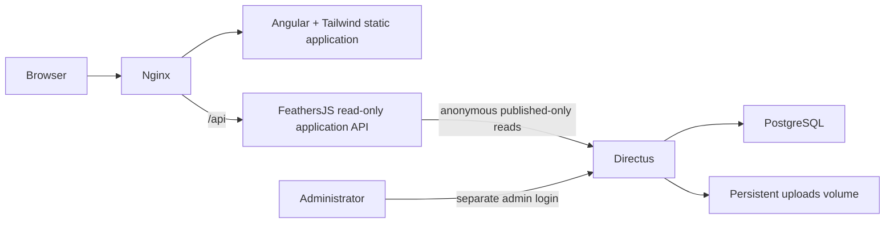

# Architecture and setup plan



The website runs on the development computer and Raspberry Pi 5 using the same Compose file. No cloud hosting is required. Only Nginx exposes the website; PostgreSQL and Feathers stay on the internal Docker network. Directus binds to localhost by default, with an explicit trusted-LAN setting documented for the Pi.

## Root structure

```text
frontend/     Angular, Tailwind, reusable teaching components
backend/      FeathersJS services and CMS access
cms/          Additive Directus schema, roles, media folders, seed importer
content/      Editable seed lessons (imported into Directus)
scripts/      Setup and content validation
tests/        API, publication, media and URL safety tests
docs/         Architecture, CMS workflow and phase-by-phase instructions
compose.yaml  PostgreSQL, Directus, FeathersJS, Angular/Nginx
.env.example  Credential names, never real passwords
```

## Required software

- Docker Desktop with Linux containers on Windows; Docker Engine and Compose v2 on Raspberry Pi OS 64-bit.
- Node.js 22.12+ within the Node 22 line and npm for local development (the detected version is 22.23.2).
- Git and a code editor. PostgreSQL and Directus do not need separate host installations.
- An independent Node-RED installation for running the tutorials and taking screenshots. The learning website does not execute learners' flows.

## PostgreSQL, administrator and environment

Run `npm run setup:env`, then edit `.env` and set `ADMIN_EMAIL`. The script creates unique database and Directus admin passwords without printing them and never overwrites existing credentials. Compose uses POSTGRES_* as the canonical database settings; DB_* document equivalent Directus settings for non-container installation. Keep the two sets consistent if using the latter. Changing bootstrap variables does not reset an existing database or admin account.

Run `docker compose up -d postgres directus`. Wait for healthy services, then open `http://localhost:8055/admin` and sign in using ADMIN_EMAIL and ADMIN_PASSWORD from your private `.env`.

Run `docker compose --profile setup run --rm cms-setup` to add the content model and seed data. The importer does not delete collections or overwrite existing records. Then run `docker compose up -d --build`.

## Content model

All requested fields are defined in `cms/schema.mjs`. Collections: categories, modules, lessons, tutorial_steps, lesson_images, node_guides, projects, code_examples, troubleshooting, videos, site_settings. Module/category foreign keys connect lessons; steps, images, code and videos connect to lessons. Optional practice and source fields supplement the requested model.

Screenshots are Directus Files UUID relationships, stored in the persistent uploads volume. No stock or generated screenshots are substituted. Folder organization starts at Node-RED Guide. Alt text, captions, descriptions and step labels remain editable in Directus.

Videos store YouTube URLs, never iframe HTML. A shared strict parser accepts supported HTTPS YouTube hosts and 11-character video IDs and builds privacy-enhanced embed URLs. The library uses manually uploaded thumbnails; no scraping occurs.

Public access is read-only and publication-filtered, including child content and files. The Feathers API uses anonymous Directus requests, never administrator credentials. Admin authentication belongs to Directus; visitors need no accounts. Lesson progress is optional device-local storage.

## Reference documentation

- https://angular.dev/reference/versions
- https://feathersjs.com/api/express
- https://directus.com/docs/self-hosting/docker-guide
- https://directus.com/docs/api/permissions
- https://nodered.org/docs/
